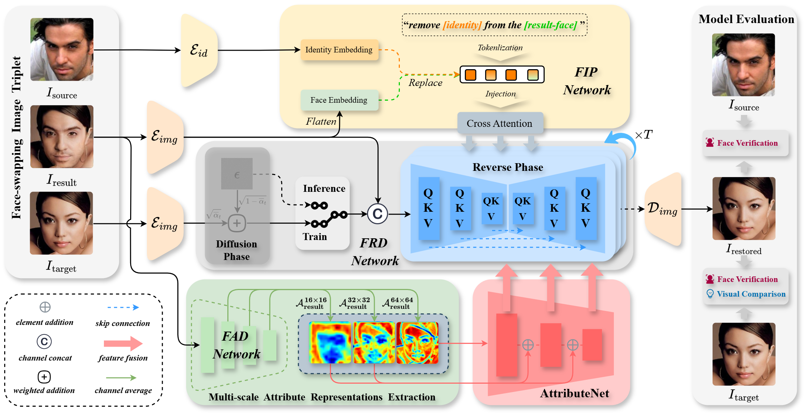

## FaceReclaim: Deep Traceability of Face-Swapped Images Through Feature Decoupling
An official implementation code for paper "[FaceReclaim: Deep Traceability of Face-Swapped Images Through Feature Decoupling]()". This repo provides code and trained weights.

## Framework
<p align='center'>  
  
</p>
<p align='left'>  
  <em>In this work, we consider the problem known as the Traceability of Face-swapping Deepfake (TFD). Unlike existing deepfake detection tasks, TFD focuses on restoring the original faces lost in the face-swapping process. Specifically, we reformulate TFD as a specialized image-to-image editing problem and propose a novel diffusion-based framework named FaceReclaim for TFD. 
  </em>
  <em>
    To ensure effective traceability, we develop a Multi-Scale Face Attribute Decoupling (FAD) and a Multi-Modal Face Identity Prompting (FIP) for dual-conditioning guidance. FAD extracts multi-scale attribute information decoupled from the synthetic face-swapped images, providing positive guidance to preserve essential attribute features during restoration.
    FIP integrates both textual and visual instructions, serving as negative guidance to explicitly direct the model in erasing identity traces of the face-swapped image.
  </em>
  <em>
    Our research shows that the synthetic face still retains subtle, traceable features of the original face, enabling its approximation and restoration.
    We evaluate our model from both visual restoration performance and the face verification perspective. Extensive experiments demonstrate the qualitative and quantitative effectiveness of our scheme. 
  </em>
</p>

---

## Dependencies

Use **Python 3.8** and install with the CUDA wheels used in our experiments:

```bash
pip install -r requirements.txt \
    --extra-index-url https://download.pytorch.org/whl/cu116
```

> Keep `transformers==4.29.2` and `tokenizers==0.13.3` (newer transformers
> disables PyTorch < 2.5).

## Pretrained weights

We publish only the weights **trained by us**; official weights are downloaded
from their original sources (see the table).

| What | File | Where to place |
|---|---|---|
| FaceReclaim main model (ours) | `last.ckpt` | `checkpoints/last.ckpt` |
| VAE (ours, f=4 AutoencoderKL) | inside `FaceReclaim_weights.tar.gz` | `checkpoints/vae.ckpt` |
| ArcFace (ours) | inside `FaceReclaim_weights.tar.gz` | `checkpoints/arcface_checkpoint.tar` |
| FAD attribute encoder (ours) | inside `FaceReclaim_weights.tar.gz` | `attribute/injection/weights/G_net_epoch_1000.pth` |
| resnet face model (ours) | inside `FaceReclaim_weights.tar.gz` | `attribute/injection/weights/resnet18_110.pth` |
| CLIP ViT-L/14 (**official**, not ours) | [openai/clip-vit-large-patch14](https://huggingface.co/openai/clip-vit-large-patch14) | `ldm/modules/encoders/openai/clip-vit-large-patch14/` |


**Note: The pretrained model weights can be downloaded from [Baidu Pan](https://pan.baidu.com/s/16TNn-4J8Xe5z_LAkbkRmzg?pwd=r458) and [Baidu Pan](https://pan.baidu.com/s/1Zbc0_wtsoBq8HQ5VRQIvJQ?pwd=i2g2). The training data can be downloaded from [Baidu Pan](https://pan.baidu.com/s/1dHK2mqBnFSw8DMqf4ny7Ng?pwd=638d). The demo test data can be downloaded from [Baidu Pan](https://pan.baidu.com/s/1FWNA44J7UnsUdHiKAlTNWQ?pwd=n4s9).**

## Inference

Run inference on the bundled 20-sample test set (`data/test`). The multi-scale
masks are optional: if you do not provide them, they are generated
automatically.

```bash
python inference.py \
    --source_folder data/test/source \
    --target_folder data/test/target \
    --result_folder data/test/result \
    --mask_root data/test/mask_FAD \
    --save_folder data/test/recover
```

Restored faces are written as `<id>_recover.jpg` under `--save_folder` (20 images
for `data/test`). Any dataset with the same layout (`source/`, `target/`,
`result/`, files named `<id>_source.jpg`, `<id>_target.jpg`, `<id>_result.jpg`)
can be used the same way.

## Training

The training pipeline has three stages (see `checkpoints/README.md` for the
required weights).

### Stage 1 - Train the FAD network (attribute decoupling)

Point `attribute/train.py` to your training images (`AttDataset(img_path=...)`),
then:

```bash
cd attribute && PYTHONPATH=<repo-root> python train.py
```

The trained attribute encoder (e.g. `att_encoder_epoch_1000.pth`) is used in
Stage 2 as `G_net_epoch_1000.pth`
(see `attribute/injection/weights/README.md`).

### Stage 2 - Generate the multi-scale masks for a faceswapped set

```bash
cd attribute/injection
python extract_attribute_generic.py \
    --result_dir <result_faces> \
    --mask_dir   <mask_output> \
    --gnet_weights weights/G_net_epoch_1000.pth \
    --face_weights weights/resnet18_110.pth \
    --gpu 0
```

This writes `<mask_output>/mask_{64,32,16}/`.

### Stage 3 - Train FaceReclaim (FRD + FAD + FIP)

The shipped config hard-codes the dataset locations; override them on the
command line (no file editing). For example, with the released 60k training
triplets (InfoSwap + CodeSwap + DiffFace) and any validation layout:

```bash
T=<path-to>/infoswap-diffface-codeswap   # contains source/, target/, result/, mask/mask_{64,32,16}
V=<path-to>/val                          # validation source/, target/, result/, mask_{64,32,16}
python main.py --base configs/FaceReclaim_s1.yaml -n FaceReclaim_s1 -l logs \
    lightning.trainer.gpus=0 \
    data.params.train.params.source_folder=$T/source \
    data.params.train.params.target_folder=$T/target \
    data.params.train.params.result_folder=$T/result \
    data.params.train.params.mask_64=$T/mask/mask_64 \
    data.params.train.params.mask_32=$T/mask/mask_32 \
    data.params.train.params.mask_16=$T/mask/mask_16 \
    data.params.validation.params.source_folder=$V/source \
    data.params.validation.params.target_folder=$V/target \
    data.params.validation.params.result_folder=$V/result \
    data.params.validation.params.mask_64=$V/mask_64 \
    data.params.validation.params.mask_32=$V/mask_32 \
    data.params.validation.params.mask_16=$V/mask_16
```


## Citation
If you use this code for your research, please cite our paper
```
@article{li2026facereclaim,
  title     = {FaceReclaim: Deep Traceability of Face-Swapped Images Through Feature Decoupling},
  author    = {Li, Yuanman and Niu, Yuanchen and Wu, Haiwei and Zhang, Yushu and Zhou, Jiantao and Li, Bin},
  journal   = {IEEE Transactions on Information Forensics and Security},
  volume    = {21},
  pages     = {5748--5762},
  year      = {2026},
  publisher = {IEEE},
  doi       = {10.1109/TIFS.2026.3694648}
}
```
